# How scanning works

The scanner reads a DiceKey from the camera. A DiceKey has 25 dice in a 5x5 box, and each die shows a letter, a digit and a rotation. The scanner is in `Packages/ReadDiceKey/Sources/ReadDiceKey/` and is written in Swift. It uses only system frameworks and the package's own `DiceKeySpecification` module. The system frameworks are Foundation (with Dispatch), `simd`, CoreGraphics, CoreVideo, CoreText and Accelerate. CoreText and Accelerate read the printed text. This document explains what the scanner reads and how it reads it. It also explains why the scanner works this way and not like the measured alternatives.

Steps 2 and 3 follow DiceKeys' own scanner, [read-dicekey](https://github.com/dicekeys/read-dicekey) (C++ on OpenCV), in how they find and decode the bars. Because of this, `Bars.swift` and `Undoverline.swift` are derivative works (`THIRD_PARTY_LICENSES`). The rest is this scanner's own design. The section "Against read-dicekey" in `scanning-measurements.md` measures the two scanners on the same photos.

## What it is built for

- **Never read a key wrong.** A misread face silently derives different secrets. Every rule below makes the scanner more likely to read nothing than to guess.
- **Read a well-framed key within a few frames on a phone,** and keep the phone cool.
- **Stay small enough to maintain.** Use Swift and no dependencies. Use system frameworks only where they measurably do the job.
- **Not a goal: photos far outside what the scanning overlay asks for.** A key under a steep tilt, with blur, or cropped may read nothing. It must never read wrong.

## What a face carries

A face has a letter (A to Z, without Q) and a digit (1 to 6) for people. For machines it has a black bar under the text (the underline) and one over it (the overline), each with 11 dot positions. The scanner reads the bars, and the bars carry everything:

- **Which face.** 150 faces use 150 of the 256 underline codes and 150 of the 256 overline codes.
- **Which way it is turned.** The 1 is at the letter end and the 0 is at the digit end. So the bits run in the direction that the face reads.
- **A cross-check.** A face's two codes are different numbers that name the same face. Every code is one bit away from another valid code, so one misread line goes unnoticed. To make both lines agree on another face, a misread needs at least four wrong dots across the two lines, in the right places. Every face has another face exactly four dots away. The four dots split between the lines as 1 and 3, 2 and 2, or 3 and 1. This protects against errors that strike the lines independently. It doesn't protect against one cause that strikes both lines. For example, a cover or the frame's edge over the same end of both bars makes the same dots of both bars wrong. Step 4 keeps such lines from agreeing on their own.

A face counts as read when one of these is true:

- Its underline and overline, both found as bars, name the same face.
- One of its lines names the face, and its printed letter and digit also clearly pick that face (step 5).

If the scanner finds no bar for a line, it reads the line only where the grid puts it. Such a line never counts without the text (step 4). Neither rule ever accepted a wrong face over the photo corpus.

The scanner reads the text with Inconsolata Bold, the font that the dice are printed in (`PrintedFont.swift` in `DiceKeySpecification`). The app draws dice from the same font.

## The pipeline

Each camera frame goes through six steps.

```mermaid
flowchart LR
    A["Camera frame (Y'CbCr)"] -->|"1. centered square of the luma plane"| B[Gray image]
    B -->|"2. 12 thresholds, keep bar-shaped dark regions"| C[Bars]
    C -->|"3. sample 11 dots, decode"| D[Undoverlines]
    D -->|"4. fit the 5x5 grid, read each slot"| E[Faces in 25 slots]
    E -->|"5. read the text where the lines disagree"| G[Faces settled]
    G -->|"6. merge with earlier frames"| F[DiceKey]
```

### 1. The frame (`GrayImage.swift`, app `CameraSession`)

The scanner takes the centered square of the luma plane, the square that the preview shows. AVFoundation rotates the buffers to match the preview, and the rotation coordinator's preview angle keeps the picture level with the horizon. The interface turns with the device in every orientation it supports, so the frame is upright on the screen as the user holds the device. The key's first row is the one nearest the top of the screen.

### 2. Finding bars (`Bars.swift`, `Regions.swift`)

The light across a key is rarely even, with glare on one corner and a shadow on another. So no single brightness threshold separates every bar from its die, but for each bar some threshold does. The scanner thresholds the frame at twelve levels, in parallel, and at the right level each bar is its own region. Most regions aren't bars (paper texture, the box, letters, the scene). Two facts about a key thin them out: all 50 bars are the same size, and a bar is found at several thresholds.

### 3. Reading a bar (`Undoverline.swift`)

The dots must split clearly into dark and light. Dots that barely split could just as well split in another place, and that gives another code. In a frame saved from the app, motion blur along the bars made both bars of one die read the same wrong face. This rule refuses those two bars. It also refuses the one face of the corpus video that the scanner otherwise read wrong. If no face has the code, the scanner drops the line. Step 4 then reads the slot of that line at the grid.

### 4. Assembling the grid (`GridFit.swift`, `Grid.swift`, `Slots.swift`)

Each line says where the middle of its face is, and a die's two lines say the same place. The scanner fits the grid to the face middles of all the lines read, whether or not a line's partner was found. Then it reads each of the 25 slots where the grid puts it. If the lines don't pass the gates under "Why each gate is there", the frame reads nothing.

- **Reading at the grid.** The scanner reads a slot that is missing a line at the place where the line must be. This recovers lines that are too faint, broken up, near or far to be found as bars. It reads a bar this way only if both its ends are in the frame. Two alternatives were measured:
  - Reading bars that the edge cuts read 2 more faces from the `other/` photos over the four sizes and 3 more from the saved frames. It also completed a synthetic key wrong.
  - Refusing every line with an end outside the frame, however the scanner found the line, read 72 fewer faces from the `other/` photos and 81 fewer from the saved frames.
- **Lines cut short.** The frame's edge, or a cover such as glare or a light finger, can cut a bar short at its digit end. The bar can still pass as a bar, because step 2 keeps rectangles down to three quarters of the bars' area. The samples then fall on the same wrong dots of both bars of a die cut at the same place. So both bars name the same wrong face and agree: R5 for R4 in synthetic frames. The scanner leaves out a line that measures under 0.95 of the median line's length on the grid, and reads its slot at the grid instead. A rule that leaves out only short lines that end at the frame's edge misses the cover. This rule reads 2 fewer faces from the well-framed photos over the four sizes. It reads 1 more from the `other/` photos and 2 more from the saved frames.
- **A line read at the grid is no vote on its own.** The lines of a slot settle its face alone only when the scanner found both as bars and they agree. A line read at the grid needs the text (step 5) to name the face too, for two reasons:
  - **The same wrong face on both lines.** Whatever kept the scanner from finding a bar can make the line read there name the same wrong face as the line beside it. In synthetic frames, a cover turns L4 into L3 on both lines, and a dark band across the same dots of both lines turns H5 into F5.
  - **Noise.** Where there is no bar at all, noise decodes a face by chance. With every underline removed from a synthetic key, reading the place of the underline gave a line in 871 of 11,424 slots at sensor noise of 4 to 14 gray levels, and none at noise 0. In 6 of the 871, the line named the face of the overline beside it. In another test, the blank place read as the underline of a wrong face in 8 of 6,000 frames before the rule and in none after. One such frame, beside a clean frame of the other 24 dice, completed a wrong key.

  The text is an independent vote where the cause leaves the text alone, as a band across the bars does. But the frame's edge cuts the text together with the bars: a die cut in half read K3 as K1 on its bar and its text alike. This is why the scanner doesn't read bars that the edge cuts at the grid. Compared with trusting such lines, the rule reads 16 fewer faces from the `other/` photos over the four sizes, 141 fewer from the saved frames and 4 fewer from the well-framed photos. In two of the four saved sets, the key is complete one frame later, at frame 46 and 41 instead of 45 and 40.

**Why each gate is there.** Dice that aren't a key can line up too. So the grid has to show that it is the key's before the scanner reads any slot.

- **Exactly five columns and rows:** the slots are the key's 25. If a whole column or row is out of view, nothing says which one is missing.
- **Lines in every column and row:** the scanner fitted a grid across a tilted key whose bottom row was out of view. The grid put the lines of the key's first, second and fourth rows in rows 0, 1 and 4, with nothing between them. It read the fourth row as the fifth. This gate reads 1 fewer face from the `other/` photos at the app's scale and none fewer from the saved frames.
- **Faces of one size on the grid:** for a turned and steeply tilted key, the scanner pinned a grid that stretched over all five rows. That grid read six faces wrong.
- **60% of the lines on the key:** scattered or jumbled dice put 31 to 41% of their lines on the best grid. A key puts at least 69% there.
- **Two slots in each outermost row and column:** without this gate, a single stray line past the key's edge pinned the grid a column off in a frame saved from the app. A die beyond the edge fills one slot, never two.

### 5. Reading the text (`FaceText.swift`)

A slot gets a second chance from its printed letter and digit only when it has at least one line but its lines were not both found as bars and agreeing. A frame whose lines all agree skips this step. The scanner draws the 150 faces once, in 3 ms on an M4 Pro on first use. It takes about 1 ms to read the text of one die. A face settled by text then counts like any other in step 6.

**Why each check is there.** The text match alone isn't safe. Over all four sizes, the corpus has 3,630 dice whose two lines were found and agree. For these dice, the best match was the right face every time, but only at the die's true orientation and size. In a test, the scanner read each die 10 times off its true orientation or size. The readings were a quarter, half or three quarters of a turn off, or 85% to 120% of its true size (in steps of 5%). Another face matched clearly enough to pass the score and the lead 1,070 times: 293 turned, 777 resized. A die whose lines disagree is exactly where the size can be wrong, because a broken bar measures short. The quarter-turn lead refused all 293 turned matches. The size check refused all 777 resized ones, at the size the other dice predict as well as at the true size. The plane fitted to the other dice predicts the size of a die within 3.4% in 98 cases of 100.

Another test shifted the center that the scanner samples the text at, by a quarter of the step between dice (0.41 of a face at the median). A line's face middle can lie at most this far from its slot's middle and still go to that slot. So the shift is a conservative bound on the error in the center. A wrong face passed the score and the lead 2 times in 29,040 (8 shifts of each die). Once, a wrong face also passed the quarter-turn lead. Now a misread needs two things. A misread line must name exactly the face that the text wrongly matches, and that match must pass every check.

### 6. Across frames (`DiceKeyScanner.swift`)

One frame rarely reads all 25 faces, so the scanner keeps the faces from every frame it reads. A frame that reads nothing changes nothing.

The key is read when all 25 faces are known and name 25 different letters. A DiceKey has one die per letter. A full sheet of Stickeys stickers repeats five letters. Without this check, it would read as a key. This is also the last guard on step 5's letter check, which sees only one frame.

Stickeys are DiceKeys' stickers for backing up a key. They carry the same bars and layout as the dice, but larger, with no box around them. A kit holds "150 stickers (one for each die face)", and the backup is "a 5x5 grid of stickers that matches your DiceKey" ([DiceKeys FAQ](https://dicekeys.com/faq/)). It is cut from sheets of five letters with every digit ([`StickerSheetView.tsx`](https://github.com/dicekeys/dicekeys-app-typescript/blob/main/web/src/views/SVG/StickerSheetView.tsx)). A backup can repeat letters. DiceKeys' own app checks for one of each letter only when asked ([`validateDiceKey.ts`](https://github.com/dicekeys/dicekeys-app-typescript/blob/main/web/src/dicekeys/DiceKey/validateDiceKey.ts), `requireOneOfEachLetter`, false by default). `diceKey` refuses such a key, because it needs 25 different letters. Step 5's letter check never settles a die whose letter another die in the frame shows. The rest of this paragraph is an inference that no source states. One kit has each face once. So a backup that repeats a letter does so with different digits, or with stickers from a second kit.

## Speed

`ScannerBenchmarkTests` is opt-in. To run it:

1. Go to `Packages/ReadDiceKey`.
2. Run `SCANNER_BENCHMARK=1 swift test -c release --filter ScannerBenchmark`.

The benchmark times a scan of one 1080x1080 frame, the app's square, whose lines all agree. On a Mac, the scan takes a few milliseconds (3.6 ms on an M4 Pro) and raises peak memory by about 13 MB. Each die that step 5 reads adds about 1 ms. Nobody measured the scan on a phone. On an iPhone, a well-framed key reads in a few frames, and the phone stays cool.

## Accuracy and the corpus

`ScannerCorpusTests` runs photos and a short video of keys. They are read-dicekey's and the owner's (one key is the one printed in the DiceKeys booklet). It also runs scenes with no key. The standard for a photo depends on how the photographer took it, not on who took it:

- **A well-framed key must read** (the photos in `well-framed/`). The test uses each photo at the app's scale, with the shorter side scaled to 1,080 pixels. The test doesn't crop the photos, because the photographers didn't frame them through the app's square. The scanner must read at least 20 faces from one frame of each such photo. It must do so in two cases: filling the frame, and at three quarters of that size. The second case is a key held back to fit the scanning target. The scanning target is a window over the middle three quarters of the frame. The scanner must also read at least a recorded total across all of the photos. The total is a little below the 866 that the photos read at the app's scale.
- **Everything else has one requirement only: it must never be misread** (the photos in `other/`). This covers:
  - a steep tilt
  - low light
  - blur
  - a key far away under glare
  - a key in low light with its bottom row washed out
  - a cropped key
  - the video at 360 pixels
  - scenes with no key at all (loose and jumbled dice, printed faces, Stickeys sheets, a sudoku grid), which must read nothing

The tests check every photo for misreads at full size, at the app's scale and three quarters of it. They also check each photo cropped to the centered square exactly as the app scans it. The scanner never read a face wrong in any of them. The photos far outside what the scanning overlay asks for are in the corpus to prove this. The scanner doesn't have to read them.

## Measurements

`scanning-measurements.md` compares this scanner with read-dicekey, gives the reasons and numbers behind its constants, and lists the approaches it tried and dropped.

## Limitations

- A die can never be read if one of its lines is damaged or not found as a bar and its text is unclear. The user has to type in such a key.
- Text settles nothing in a frame with fewer than three dice whose lines agree. The sizes of those dice tell the scanner the size to read the text at.
- A frame only counts when what is in view pins the grid to the key's 5x5. A key partly out of frame reads the dice in view as long as these conditions hold. A key with a whole column or row out of view reads nothing. The conditions are:
  - lines in every row and column
  - lines in at least two slots of each outermost row and column
  - at least 60% of the frame's lines on the key
  - the faces all of one size on the grid
- The scanner reads a key a column or row off if two things are true. First, an outer column or row of the key is out of view, or mostly out of view. Second, two or more stray dice lie exactly on its grid beyond the opposite edge. The strays fill two slots of the column or row past the edge, and that column or row passes for the key's. The merge starts over when a correct frame disagrees with it.
- A steeply tilted key reads less, or nothing. The flat grid must hold most of the key before perspective refines it. Under a steep tilt, the far dice lie more than a quarter step off any flat grid. The scanner refuses a grid stretched across such a tilt, with its faces far from one size in columns and rows. The scanning overlay asks for the key face on.
- Blur, and the silver reflection that a lamp can raise from the etched bars, lose dice for that frame. When the user moves the phone, the dice come back.
- If a die is turned over while the scanner scans the key, the scanner notices only when a frame reads that die again. Until then, the scanner keeps the face it read before.
