# How scanning works

The scanner reads a DiceKey from the camera. A DiceKey has 25 dice in a 5x5 box, and each die shows a letter, a digit and a rotation. The scanner is in `Packages/ReadDiceKey/Sources/ReadDiceKey/` and is written in Swift. It uses only system frameworks and the package's own `DiceKeySpecification` module. The system frameworks are Foundation (with Dispatch), `simd`, CoreGraphics, CoreVideo, CoreText and Accelerate. CoreText and Accelerate read the printed text. This document explains what the scanner reads and how it reads it. It also explains why the scanner works this way and not like the measured alternatives.

Steps 2 and 3 follow DiceKeys' own scanner, [read-dicekey](https://github.com/dicekeys/read-dicekey) (C++ on OpenCV), in how they find and decode the bars. Because of this, `Bars.swift` and `Undoverline.swift` are derivative works (`THIRD_PARTY_LICENSES`). The rest is this scanner's own design. The section "Against read-dicekey" measures the two scanners on the same photos.

## What it is built for

- **Never read a key wrong.** A misread face silently derives different secrets. Every rule below makes the scanner more likely to read nothing than to guess.
- **Read a well-framed key within a few frames on a phone,** and keep the phone cool.
- **Stay small enough to maintain.** Use Swift and no dependencies. Use system frameworks only where they measurably do the job.
- **Not a goal: photos far outside what the scanning overlay asks for.** A key under a steep tilt, with blur, or cropped may read nothing. It must never read wrong.

## What a face carries

Every face has two layers of information.

- **For people:** a letter (A to Z, without Q) and a digit (1 to 6).
- **For machines:** a black bar under the text (the underline) and one over it (the overline). Each bar has 11 dot positions. A white dot is a 1. Read from the letter end, the 11 bits are a 1, a flag that is set on the overline, an 8-bit code, and a 0.

```
            letter end ─────────────────────────────► digit end
  dot:        1      2         3  4  5  6  7  8  9  10     11
  bit:        1   overline  └──────── 8-bit code ───────┘   0
```

The scanner reads the bars, and the bars carry everything:

- **Which face.** 150 faces use 150 of the 256 underline codes and 150 of the 256 overline codes.
- **Which way it is turned.** The 1 is at the letter end and the 0 is at the digit end. So the bits run in the direction that the face reads.
- **A cross-check.** A face's two codes are different numbers that name the same face. Every one of the 150 underline codes and 150 overline codes is one bit away from another valid code. So one line can be misread, and nothing notices. To make both lines agree on another face, a misread needs at least four wrong dots across the two lines, in the right places. Every face has another face exactly four dots away. The four dots split between the underline and the overline as 1 and 3, 2 and 2, or 3 and 1. This protects against errors that strike the lines independently. It doesn't protect against one cause that strikes both lines. For example, a cover or the frame's edge over the same end of both bars makes the same dots of both bars wrong. Step 4 keeps such lines from agreeing on their own.

A face counts as read when one of these is true:

- Its underline and overline, both found as bars, name the same face.
- One of its lines names the face, and its printed letter and digit also clearly pick that face (step 5). The scanner compares the printed letter and digit with all 150 faces.

If the scanner finds no bar for a line, it reads the line only where the grid puts it. Such a line never counts without the text (step 4). Neither rule ever accepted a wrong face over the photo corpus.

The `DiceKeySpecification` module holds the 150 faces with their codes and the whole printed layout in `FaceSpecification.swift`. DiceKeys' specification generator (written in TypeScript) generated that file, and this repository trimmed it. The module also holds the font that the dice are printed in, Inconsolata Bold, which `PrintedFont.swift` loads. The scanner reads with the font, and the app draws dice from it.

## The pipeline

Each camera frame goes through six steps.

```mermaid
flowchart LR
    A["Camera frame (Y'CbCr)"] -->|"1. centered square of the luma plane"| B[Gray image]
    B -->|"2. 12 thresholds, keep bar-shaped dark regions"| C[Bars]
    C -->|"3. sample 11 dots, decode"| D[Undoverlines]
    D -->|"4. fit the 5x5 grid, read each slot"| E[Faces in 25 slots]
    E -->|"5. read the text where the lines disagree"| G[Faces settled]
    G -->|"6. merge with earlier frames"| F[DiceKey]
```



### 1. The frame (`GrayImage.swift`, app `CameraSession`)

The camera delivers bi-planar Y'CbCr. Its first plane is luma, which is already the grayscale image the scanner needs. The scanner takes the centered square of the luma plane (what the square preview shows). It makes one copy for each row. AVFoundation rotates the buffers to match the preview before they arrive. So the scanner works in the coordinates the user sees. The rotation coordinator's preview angle keeps the picture level with the horizon. The interface turns with the device in every orientation it supports (portrait and both landscapes on an iPhone, every way on an iPad). So the frame is upright on the screen as the user holds the device. The key's first row is the one nearest the top of the screen.

### 2. Finding bars (`Bars.swift`, `Regions.swift`)

A bar is dark against its own die, but the light across a key is rarely even. For example, glare falls on one corner and a shadow falls over another. No single brightness threshold separates every bar from its die, but for each bar some threshold does. So the scanner thresholds the frame at twelve levels: `k * 255 / 13` for k = 2 to 13. It skips levels above the brightest pixel. At each level, the scanner groups the dark pixels into regions. It finds runs of dark pixels along each row, and it joins runs in neighboring rows that share a column. At the right level, each bar is its own region.

The scanner fits each region of at least 50 pixels with its smallest enclosing rectangle (one side lies along an edge of its convex hull). It keeps the rectangle if it has an undoverline's proportions: 0.177 as thick as it is long, within a factor of 1.5 either way. The levels are independent, so they run in parallel.

Most regions aren't bars (paper texture, the box, letters, the scene). Two facts about a key thin them out:

- **All 50 bars are the same size.** The scanner sorts the areas and finds the tightest run of 35. Only candidates with an area from 0.75 to 1/0.75 times the middle area of that run stay. A tight run of much larger rectangles wins over a tight run of tiny ones, so specks of equal size can't outvote the bars.
- **A bar is found at several thresholds.** Of overlapping candidates (the center of one is inside the other), the scanner keeps the one with the area closest to that middle area.

### 3. Reading a bar (`Undoverline.swift`)

The scanner reads the dots along the line through the middle of the rectangle. So it first finds the two ends of that line. A rectangle found at one threshold can take in a little of what the bar touches, or miss a blurred end. So the scanner puts each end where the brightness drops most steeply into the bar. It searches within 3% of the bar's length either side of the rectangle's end. The steepest edge stays in place where a fixed brightness doesn't. A metallic sheen on the ink, or a shadow on the die just past the bar, moves the place where a threshold is crossed. It moves the place by several pixels. That is enough to slide the dots onto their edges.

The scanner samples the 11 dots along the line. Each dot is the median of up to 21 pixels around its center (fewer when the dots are small). The scanner splits the dots into dark and light at the brightness that leaves the two groups tightest. Each side has at least four dots (every code has 4 to 7 light dots). The split must be clear. The scanner measures the gap between the lightest dark dot and the darkest light dot. The gap must be at least a fifth of the distance between the two groups' mean brightness. If it isn't, the scanner doesn't read the line. Dots that barely split could just as well split in another place, and that gives another code. In a frame saved from the app, motion blur along the bars made both bars of one die read the same wrong face. This rule refuses those two bars. It also refuses the one face of the corpus video that the scanner otherwise read wrong. The rule drops 1.6% of the lines that read right and 28% of those that read wrong.

The bits decode into three things: the face, whether the line is an underline or an overline, and which end is the letter end. If no face has the code, the line is a misread, and the scanner drops it. Step 4 then finds the slot of that line without the line. It reads the line again where the grid puts it.

### 4. Assembling the grid (`GridFit.swift`, `Grid.swift`, `Slots.swift`)

Each line says where the middle of its face is: 0.41 of a face from the middle of the line, toward the text. A die's two lines say the same place. The dice of a key lie a step apart along its rows and columns. The scanner fits the grid to the face middles of all the lines read, whether or not a line's partner was found. Then it reads each of the 25 slots where the grid puts it.

- **Step and direction.** For each face middle, the scanner finds the distance to the nearest face middle that is more than 0.8 of a face away. That face middle is on another die. The step from die to die is the median of these distances. A step shorter than a face can't be dice side by side. Rows run in the direction that the lines share. The scanner multiplies the angles of the lines by four, so that the four turns of a face become one direction, and averages them. The mean divided by four lies within 45 degrees of the frame's x axis. So row 0 is the top of the key as the camera sees it.
- **Anchor.** The scanner tries each face middle in turn as column 0 and row 0 of a flat grid with that step and direction. It keeps the grid that puts the most face middles within a quarter step of a whole column and row.
- **Flat refits.** The scanner refits the grid to those face middles by least squares, three times. The refits are flat: rows and columns stay straight, parallel and evenly spaced. Each time, the scanner gathers the middles on whole columns and rows afresh.
- **Strays.** While the middles span more than five columns, the scanner looks at the two outermost columns. It drops the one with fewer lines (the lower one on a tie) if that column holds no more than two lines. Two lines are one die's worth. Such a column is strays: a die beside the key, or a line read on something else. If the middles span one column too many, there is an extra condition. The scanner drops the column only if the column at the other end has lines in at least three slots. Otherwise either end could be the strays, and the frame reads nothing. An example is an outer column of the key that shows one die, with two stray dice at the other end of the span. The scanner does the same for rows.
- **Perspective.** If at least 16 lines are left, the scanner refits the grid three times in perspective. In perspective, rows converge and dice shrink with distance. Each time, the scanner gathers the middles afresh, but only within one column or row of the middles that the flat grid kept. Then the scanner drops strays again.
- **Pinning.** The scanner pins the grid to the key when the lines left meet five conditions. First, they lie in each of five columns and five rows side by side, and in no others. Second, they number at least 8. Third, they make up at least 60% of all the lines read in the frame. Fourth, they fill at least two slots of each outermost row and column. Fifth, every line in the slots of those columns and rows is much the same length in columns and rows. None is more than half the median off it. If the lines meet all five conditions, their first column and row become column 0 and row 0. Otherwise the frame reads nothing.
- **Reading at the grid.** Each line goes to the slot that its face middle is in. The face middle must be within a quarter step of the slot's middle along each axis. If a slot gets two lines of one kind, the scanner keeps the one nearer the middle. The scanner leaves out a line that measures under 0.95 of the median line's length on the grid (see "Lines cut short" below). Then the scanner reads each slot that is missing a line, at the place where the line must be. This recovers lines that are too faint or broken up to be found as rectangles. It also recovers lines that are too near or too far for their size to pass as that of a bar. A line that the slot holds says where the other line of its face is. For a slot that holds neither line, the scanner tries bars on all four sides of the middle of the slot. The scanner places these bars in columns and rows, where every face is the same square however perspective shows it. Only then does it map the bars into the frame, so perspective can't stretch them. For a slot that holds no line, the side of the face is the median length of the lines read, measured in columns and rows. The scanner reads a bar this way only if both its ends are in the frame. Past the frame's edge, a dot samples as dark, so a bar that the edge cuts reads as another code. A line read this way fills the slot if two things are true. The slot still lacks a line of that kind, and the face middle of the line is in that slot. Measured alternatives:
  - One alternative read bars that the edge cuts. It read 2 more faces from the `other/` photos over the four sizes and 3 more from the saved frames. It also completed a synthetic key wrong.
  - Instead, another alternative refused every line with an end outside the frame, however the scanner found the line. It read 72 fewer faces from the `other/` photos and 81 fewer from the saved frames.
- **Lines cut short.** The frame's edge, or a cover such as glare or a light finger, can cut a bar short at its digit end. The bar can still pass as a bar, because step 2 keeps rectangles down to three quarters of the bars' area. The scanner then samples the dots along the shortened length, and the samples fall on the wrong dots of the code. They fall on the same wrong dots on both bars of a die cut at the same place. So both bars name the same wrong face and agree: R5 for R4 in synthetic frames. The scanner leaves out a line that measures under 0.95 of the median line's length on the grid. It reads the slot of that line at the grid instead. There, it refuses the bar if the frame cuts it. Otherwise, the line is one that the text must confirm (see the next item). This rule reads 2 fewer faces from the well-framed photos over the four sizes. It reads 1 more from the `other/` photos and 2 more from the saved frames. A rule that leaves out only short lines that end at the frame's edge misses the cover. Synthetic tests of the threshold:
  - The frame's edge cut the digit end of every face, upside down, at 22,950 positions. At 0.95, no face was wrong. At 0.92, 6 faces were wrong.
  - A cover in the die's own white lay over the digit end at 3,900 positions. At 0.95, no face was wrong. At 0.92, 4 faces were wrong.
- **A line read at the grid is no vote on its own.** The lines of a slot settle its face alone only when the scanner found both as bars and they agree. A line read at the grid, where the scanner found no bar, needs the text (step 5) to name the face too. Four points follow:
  - **The same wrong face on both lines.** Something can keep the scanner from finding a bar, such as a finger or the frame's edge over its digit end. That same thing can make a line read there name the same wrong face as the line beside it. It can also make the line name the same wrong face as the other line read there. In synthetic frames, a cover turns L4 into L3 on both lines. A dark band across the same dots of both lines turns H5 into F5 on both lines.
  - **Noise.** Where there is no bar at all, noise decodes a face by chance. One test removed every underline from a synthetic key. At sensor noise of 4 to 14 gray levels, reading the place of the underline gave a line in 871 of 11,424 slots. At noise 0, it gave none. In 6 of the 871 lines, the line named the face of the overline beside it. In another test, a synthetic L1 showed a washed-out underline and one smudged dot in its overline. The smudge makes the overline name L3. Before the rule, the blank place read as L3's underline in 8 of 6,000 frames at noise 4. After the rule, it did so in none of 6,000 frames. One such frame, beside a clean frame of the other 24 dice, completed a wrong key.
  - **The text.** The text is an independent vote where the cause leaves the text alone. A band across the bars misses the text. But the frame's edge cuts the text together with the bars. A die cut in half read K3 as K1 on its bar and its text alike. This is why the scanner doesn't read bars that the edge cuts at the grid.
  - **The cost.** Compared with trusting such lines, the rule reads 16 fewer faces from the `other/` photos over the four sizes. It reads 141 fewer from the saved frames and 4 fewer from the well-framed photos. The rule first covered slots with both lines read at the grid. Those slots account for 4 of the 16, 15 of the 141 and none of the 4. In two of the four saved sets, the key is complete one frame later, at frame 46 and 41 instead of 45 and 40.
- **Rotation.** Each face's turn is its reading direction relative to the grid's rows at its slot, in quarter turns.

**Why each gate is there.** Dice that aren't a key can line up too. So the grid has to show that it is the key's before the scanner reads any slot.

- **Exactly five columns and rows:** the slots are the key's 25. If a whole column or row is out of view, nothing says which one is missing.
- **Lines in every column and row:** the scanner fitted a grid across a tilted key whose bottom row was out of view. The grid put the lines of the key's first, second and fourth rows in rows 0, 1 and 4, with nothing between them. It read the fourth row as the fifth. This gate reads 1 fewer face from the `other/` photos at the app's scale and none fewer from the saved frames.
- **Faces of one size on the grid:** every face is the same square in columns and rows. So a line much longer or shorter there than the rest means that the grid is stretched. For a turned and steeply tilted key, the scanner pinned a grid that stretched over all five rows. That grid read six faces wrong. Its lines measured up to 0.80 of the median off it. On a grid that fits, nearly every line measures within a few percent of the median. The farthest lines are 0.22 off in the corpus and 0.40 in the saved frames, where they are single lines that measure long. The gate costs no face.
- **60% of the lines on the key:** scattered or jumbled dice put 31 to 41% of their lines on the best grid. A key puts at least 69% there.
- **Two slots in each outermost row and column:** without this gate, a single stray line past the key's edge pinned the grid a column off in a frame saved from the app. A die beyond the edge fills one slot, never two.

### 5. Reading the text (`FaceText.swift`)

After step 4, a slot is read if its two lines were found as bars and name the same face. A slot has at least one line but no such agreement in two cases. In the first case, a line is misread. In the second case, the scanner found no bar for a line and read it only where the grid puts it. Such a slot gets a second chance from its printed letter and digit. The scanner leaves every other slot alone. So a frame whose lines all agree skips this step.

**Matching.** The scanner draws the letter and digit of each of the 150 faces once, in Inconsolata Bold at the printed size and place. Each drawing is a grid of 48 samples across the face, over the band between the bars. The scanner samples the band of the die the same way, at the center, size and reading direction that the lines of the die give. It correlates the band with the drawing of every face. It shifts the band up to three samples either way, for error in its center. The face with the highest correlation is the text's best match.

**Settling.** The best match settles the slot only when all of these hold:

- it is a face that one of the slot's lines names. So the text is a second vote beside a bar, never a vote on its own.
- it scores at least 0.7 and leads the next face by 0.03.
- it leads the best match at each other quarter turn by 0.15. So its orientation is right.
- it is still the best match when the scanner samples the die at the size that the other dice predict for that slot. So its size is right. The prediction is a plane over rows and columns. The scanner fits the plane to the sizes of the dice whose lines agree, because perspective changes size smoothly. The plane needs at least three such dice, not all in one line. Where the prediction is less certain than one die's own measure, nothing is settled. For example, the prediction is less certain far from the few agreeing dice of a sparse frame.
- no other die in the frame reads the same letter, by its lines or by its text, because a key has one die per letter. If the text of two slots reads the same letter, the scanner leaves both slots unread.

A face settled by text then counts like any other in step 6.

**Why each check is there.** The text match alone isn't safe. Over all four sizes, the corpus has 3,630 dice whose two lines were found and agree. For these dice, the best match was the right face every time, but only at the die's true orientation and size. In a test, the scanner read each die 10 times off its true orientation or size. The readings were a quarter, half or three quarters of a turn off, or 85% to 120% of its true size (in steps of 5%). Another face matched clearly enough to pass the score and the lead 1,070 times: 293 turned, 777 resized. A die whose lines disagree is exactly where the size can be wrong, because a broken bar measures short. The quarter-turn lead refused all 293 turned matches. The size check refused all 777 resized ones, at the size the other dice predict as well as at the true size. When the scanner fits the plane to the other dice, the plane predicts the size of a die within 3.4% in 98 cases of 100.

Another test shifted the center that the scanner samples the text at. The shift was a quarter of the step between dice (0.41 of a face at the median). A line's face middle can lie at most this far from its slot's middle and still go to that slot. So the shift is a conservative bound on the error in the center. The center is the middle of the die's own lines, which slot placement doesn't move. A die's two lines agree on that middle within 0.1 of a face in 99 cases of 100. With the shifted center, a wrong face passed the score and the lead 2 times in 29,040 (8 shifts of each die). Once, a wrong face also passed the quarter-turn lead. Now a misread needs two things. A misread line must name exactly the face that the text wrongly matches, and that match must pass every check.

On an M4 Pro, the scanner takes 3 ms to draw the 150 faces on first use. It takes about 1 ms to read the text of one die.

### 6. Across frames (`DiceKeyScanner.swift`)

One frame rarely reads all 25 faces. The scanner keeps the faces from every frame it reads. The scanner fits the grid afresh in each frame. So the key may have turned a quarter turn since the earlier frame. Or the scanner may read the key that way when it is held near 45 degrees. The scanner tries the known faces in all four turns. It keeps the turn that agrees with the new frame on the most faces and disagrees on none. If every turn disagrees somewhere, the camera is on another key, and the scanner starts over. The scanner needs five faces in common to call it the same key, because two keys can share a face or two by chance. With fewer, the larger set of faces stands: the known faces, or the faces of the new frame. So one key isn't mixed into another on a coincidence. Successive frames of a key in view read most of its faces, so they share far more than five. A frame that reads nothing changes nothing.

The key is read when all 25 faces are known and name 25 different letters. A DiceKey has one die per letter. A full sheet of Stickeys stickers repeats five letters. Without this check, it would read as a key. This is also the last guard on step 5's letter check, which sees only one frame.

Stickeys are DiceKeys' stickers for backing up a key. They carry the same bars and layout as the dice, but larger, with no box around them. A kit holds "150 stickers (one for each die face)", and the backup is "a 5x5 grid of stickers that matches your DiceKey" ([DiceKeys FAQ](https://dicekeys.com/faq/)). It is cut from sheets of five letters with every digit ([`StickerSheetView.tsx`](https://github.com/dicekeys/dicekeys-app-typescript/blob/main/web/src/views/SVG/StickerSheetView.tsx)). A backup can repeat letters. DiceKeys' own app checks for one of each letter only when asked ([`validateDiceKey.ts`](https://github.com/dicekeys/dicekeys-app-typescript/blob/main/web/src/dicekeys/DiceKey/validateDiceKey.ts), `requireOneOfEachLetter`, false by default). `diceKey` refuses such a key, because it needs 25 different letters. Step 5's letter check never settles a die whose letter another die in the frame shows. The rest of this paragraph is an inference that no source states. One kit has each face once. So a backup that repeats a letter does so with different digits, or with stickers from a second kit.

## Speed

`ScannerBenchmarkTests` is opt-in. To run it:

1. Go to `Packages/ReadDiceKey`.
2. Run `SCANNER_BENCHMARK=1 swift test -c release --filter ScannerBenchmark`.

The benchmark times a scan of one 1080x1080 frame, the app's square, whose lines all agree. On a Mac, the scan takes a few milliseconds (3.6 ms on an M4 Pro) and raises peak memory by about 13 MB. Each die that step 5 reads adds about 1 ms. Nobody measured the scan on a phone. On an iPhone, a well-framed key reads in a few frames, and the phone stays cool.

## Accuracy and the corpus

`ScannerCorpusTests` runs photos and a short video of keys. They are read-dicekey's and the owner's (one key is the one printed in the DiceKeys booklet). It also runs scenes with no key. The standard for a photo depends on how the photographer took it, not on who took it:

- **A well-framed key must read** (the photos in `well-framed/`). The test uses each photo at the app's scale, with the shorter side scaled to 1,080 pixels. The test doesn't crop the photos, because the photographers didn't frame them through the app's square. The scanner must read at least 20 faces from one frame of each such photo. It must do so in two cases: filling the frame, and at three quarters of that size. The second case is a key held back to fit the scanning target. The scanning target is a window over the middle three quarters of the frame. The scanner must also read at least a recorded total across all of the photos. The total is a little below the 866 that the photos read at the app's scale.
- **Everything else has one requirement only: it must never be misread** (the photos in `other/`). This covers:
  - a steep tilt
  - low light
  - blur
  - a key far away under glare
  - a key in low light with its bottom row washed out
  - a cropped key
  - the video at 360 pixels
  - scenes with no key at all (loose and jumbled dice, printed faces, Stickeys sheets, a sudoku grid), which must read nothing

The tests check every photo for misreads at full size, at the app's scale and three quarters of it. They also check each photo cropped to the centered square exactly as the app scans it. The scanner never read a face wrong in any of them. The photos far outside what the scanning overlay asks for are in the corpus to prove this. The scanner doesn't have to read them.

## Against read-dicekey

The comparison script reads the corpus with read-dicekey as well as with this scanner. It prints the tables below, and one row per photo and size. To run it:

1. Make sure that Xcode, git and python3 are installed and that the network is available.
2. Run `scripts/compare-upstream/compare-upstream.sh [work dir]`.

The script builds OpenCV 4.12.0, the version read-dicekey pins, and read-dicekey at commit 0440036 in the work directory. On an M4 Pro, the build takes about 90 s, and each rerun takes about 30 s. Reruns give these faces exactly. Times move by a millisecond or so.

Both scanners read the same gray bytes. `UpstreamCompareTests` writes them as PGMs, one frame per photo at the four sizes of the corpus tests:

- full size
- the shorter side 1080, the app's scale
- the centered 1080 square the app scans
- the shorter side 810

The corpus tests' rules score the reads. read-dicekey runs `DiceKeyImageProcessor::processImage`, its grayscale entry. It uses a fresh processor for each photo, so it merges nothing. A face counts as read when its `isDefined()` says so. That needs an orientation. It also needs a majority of two of underline, overline and its OCR for the letter, and the same for the digit. read-dicekey keeps the faces of a frame only when its grid fits five rows and columns of underline and overline pairs. Otherwise it reads nothing from the frame. OpenCV runs its arm64 code paths here. Other CPUs take other code paths, which may move a face or two.

Faces right/wrong:

|  | full size | shorter side 1080 | centered 1080 square | shorter side 810 |
|---|---|---|---|---|
| well-framed (35 photos, 873 faces): this scanner | 838/0 | 866/0 | 810/0 | 862/0 |
| read-dicekey | 778/0 | 760/0 | 701/0 | 784/1 |
| read-dicekey, keys it calls complete | 20 of 35 | 20 of 35 | 18 of 35 | 21 of 35 |
| other (13 photos, 320 faces): this scanner | 129/0 | 127/0 | 128/0 | 130/0 |
| read-dicekey | 39/0 | 62/0 | 80/0 | 43/1 |
| read-dicekey, keys it calls complete | 0 of 13 | 0 of 13 | 0 of 13 | 1 of 13 |

By whose photo it is, faces right, this scanner / read-dicekey:

|  | full size | shorter side 1080 | centered 1080 square | shorter side 810 |
|---|---|---|---|---|
| read-dicekey's own well-framed (19 photos, 475 faces) | 473 / 473 | 475 / 473 | 467 / 443 | 475 / 473 |
| the owner's well-framed, added later (16 photos, 398 faces) | 365 / 305 | 391 / 287 | 343 / 258 | 387 / 311 |
| read-dicekey's own `other/` (3 photos, 75 faces) | 64 / 19 | 65 / 42 | 66 / 42 | 67 / 43 |
| the owner's `other/` (10 photos, 245 faces) | 65 / 20 | 62 / 20 | 62 / 38 | 63 / 0 |

- **On read-dicekey's own well-framed photos the two are level.** They read the same at full size, and read-dicekey is two faces behind at each shorter-side size. On the centered square, read-dicekey reads 30 fewer faces than at its other sizes. Of these 30, 25 are from `S4tI3lZ2t…_well_lit`, and read-dicekey reads no face from that photo there. This scanner reads 21 faces from it there.
- **The gaps are on the later photos and on read-dicekey's own `other/` ones.** Neither scanner reads a face from `R5bD3bV2l…-night-glare`. read-dicekey reads nothing from these:
  - either built-in-camera frame of `W1tO4tC6l…`, except 17 faces of one at full size
  - `D32T52S20…-tilted-1` at three sizes
  - `P5lU2lY5r…-blurry` or `R5bD3bV2l…-night` at three sizes
  - `D32T52S20…-left-column-cut` or `U5bC4bE1l…` at any size
- **Misreads:** this scanner has none at any size. read-dicekey has two, both at shorter side 810: `G5bS2rW5l…-glare` U4b read as A3l, and `Y6bS2rG4b…` N4b read as N3b. read-dicekey flags both as errors (`errorSize()` 10 and 255), and neither frame passes its complete-key check.
- **No key:** neither scanner reads a face from any of the nine `nokey-` photos at any size. Neither fails on `CausedCrashOn2020-09-18`, read-dicekey's crash-regression input. This scanner reads 20 faces there. Their letters and digits match the printed key by eye. The photo names no key, so the tests don't score them. read-dicekey reads none.
- **Video,** 95 frames of 360-pixel luma squares: read-dicekey fits its grid in frame 0 only (18 faces right, none wrong) and never finishes. After every other frame, its read is empty, because it clears the read whenever a frame doesn't fit. This scanner merges the frames. It knows all 25 faces by the end, with no wrong face in any frame. When it reads one frame at a time, it reads faces in 79 frames, and it reads at most 21 faces in one frame.
- **Time per frame,** median, scanning only: this scanner takes 10, 6, 4 and 4 ms at the four sizes. read-dicekey takes 58, 24, 21 and 15 ms.

What the numbers don't say:

- **The tuning used these photos,** which are the test suite of this scanner. read-dicekey's own tests use 23 of them. On the 19 that are well-framed, the two are level. Several of the owner's names record what this scanner read, with a check by eye where the picture is sharp (`Fixtures/images/README.md`). So if this scanner consistently misread a face, the score would count read-dicekey's correct read as wrong. Neither of read-dicekey's two misreads is on such a photo.
- **"Read" is read-dicekey's own standard,** which counts faces that it flags (`errorSize()` above 0). Its apps show those faces to the user to confirm. When the count includes only the faces without a flag, read-dicekey reads 6 to 14 fewer per size from the well-framed photos, and none wrong. This scanner's standard is between the two: both bars agree, or one bar and clear text.
- **One frame is a strict test for both scanners,** since both are built for a camera loop. read-dicekey runs until it finishes. It forgets the key on any frame without a grid. This scanner merges frames, and it keeps what it knows through such a frame. The corpus tests state that one frame per photo is stricter than the app.
- **The times aren't alike.** This scanner traces its threshold levels in parallel (`DispatchQueue.concurrentPerform` in `Bars.swift`). The comparison timed it inside `swift test -c release`. read-dicekey's levels run in series (OpenCV may parallelize single filters). The comparison built read-dicekey with `-O3` and timed it warm, with every photo in one process. The times leave out the time to decode a photo and to resize it.

## Constants and where they come from

The scanner's thresholds are in `Tuning.swift`, one group per step: `Tuning.Bars`, `Tuning.Lines`, `Tuning.Grid`, `Tuning.Slots`, `Tuning.Text` and `Tuning.Merge`. The printed geometry they work with is `FaceDimensionsFractional` in `DiceKeySpecification`.

| Constant | Value | Why |
|---|---|---|
| `Tuning.Bars.thresholds` | `k * 255 / 13`, k = 2...13 | read-dicekey's choice, kept after measuring fewer levels. k = 2, 4, ... 10 loses every face of the `fingers` photo in the centered square. Of 200 random sets of 4 or 5 levels, only 3 came within 2 faces of all twelve at every size. So a smaller set would be tuned to these photos |
| `Tuning.Bars.minimumRegionPixels` | 50 pixels | Drops specks before the scanner fits rectangles. A bar is far larger at any usable distance |
| `Tuning.Bars.proportionSlack` | 0.177 thick per length, within a factor of 1.5 | The printed geometry, with slack for blur and perspective |
| `Tuning.Bars.modalRunHalfWidth`, `largerRunTightness`, `largerRunFactor`, `areaTolerance` | tightest run of 35 (17 either side of its middle), or a run under 1.2 whose middle is over 3 times the area found so far. Keep 0.75 to 1/0.75 times its middle area | 50 bars of one size. 35 leaves room for missed and extra bars |
| `Tuning.Grid.sameDieDistance` | face middles within 0.8 of a face | A die's two lines put its middle in one place, within 0.1 of a face in 99 cases of 100. The middle of the next die is 1.3 to 1.9 faces away (well-framed photos, app's scale) |
| `Tuning.Slots.tolerance` | a quarter step along each axis | Unambiguous, because slots are a whole step apart. The fit also uses it to gather the faces on the grid |
| `Tuning.Slots.minimumLineLength` | 0.95 of the median line's length on the grid | A bar cut short still passes as a bar, and both bars of a die cut at the same place name the same wrong face. The first note below the table gives the measurements |
| `Tuning.Grid.refits` | 3, flat and again in perspective | Two refits read the same faces as three or four over the corpus and the saved frames. One refit read 2 fewer from the well-framed photos (one at full size, one at three quarters of the app's scale). It read 1 fewer from the saved frames |
| `Tuning.Grid.minimumLines` | 8 | Pinning needs lines in at least seven slots anyway. Minimums of 4 and 6 read the same faces over the corpus and the saved frames |
| `Tuning.Grid.minimumLinesForPerspective` | 16 | Perspective only refines a flat grid that many lines hold, since it misread when fitted to sparse dice. Without it the well-framed photos read 34 fewer faces at the app's scale |
| `Tuning.Grid.perspectiveWindow` | one column or row beyond the lines the flat grid kept | When the refit gathered lines anywhere, it caught dice five rows past the key and lost a well-framed photo |
| `Tuning.Grid.maximumStrayLines` | an outermost column or row with at most 2, the one with fewer lines, the lower on a tie | One die's two lines: a die beside the key, or a line read on something else |
| `Tuning.Grid.minimumSlotsOppositeStrays` | 3, when the lines span one column or row too many | Two stray dice fill two slots. So a column of the key that shows one die would otherwise be dropped in their place. The scanner would then read the key a column off. The second note below the table gives the measurements |
| `Tuning.Grid.minimumShareOnKey` | 60% of the frame's lines | Scattered or jumbled dice put 31 to 41% of their lines on the best grid. A key puts at least 69% |
| `Tuning.Grid.minimumSlotsOnEachEdge` | 2 | A die past the key's edge fills one slot. Without this minimum, one stray line there pinned the grid of a saved frame a column off |
| `Tuning.Grid.maximumFaceSideDeviation` | half the median length of the lines in the key's slots, in columns and rows, either way | A grid stretched by a steep tilt measured 0.80 off. Grids that fit measured at most 0.22 over the corpus and 0.40 over the saved frames. It costs no face |
| `Tuning.Grid.smallestPivot` | 1e-9 | The fit is in columns and rows, which are small numbers. Points in one line can't fix a grid, and they leave a pivot of rounding error |
| `Tuning.Merge.minimumFacesInCommon` | 5 | Too many to match by chance. Frames of a key in view share far more |
| `MinNumberOfBlackDotsInUndoverline`, `MinNumberOfWhiteDotsInUndoverline` (`DiceKeySpecification`) | 4 and 4 | Every code has at least 4 of each |
| `Tuning.Lines.minimumDotGap` | a fifth of the distance between the dark and light means | Drops 1.6% of the lines that read right and 28% of those that read wrong |
| `Tuning.Text.gridWidth`, `band` | 48 samples across a face, one per pixel of the drawn faces, over 0.22 to 0.78 of its height | The band clears both bars, and it reaches their inner edges at the largest shift. At this size, the best face was the right one for all 3,630 dice whose lines were found and agree. Samples that averaged 2x2 or 4x4 pixels read no more faces |
| `Tuning.Text.maximumShift` | up to 3 samples, about 6% of a face, either way | Covers the error in a center that the scanner infers from one line |
| `Tuning.Text.maximumSizeVariance` | no more uncertain than one die's measured size | Dice that the text settles on the corpus are predicted at a quarter of that (median 0.24), and never above 0.63 of it. Three agreeing dice in a corner would give 81 for the far corner |
| `Tuning.Text.minimumScore`, `minimumLeadOverOtherFaces`, `minimumLeadOverOtherTurns` | score 0.7, lead 0.03 over other faces and 0.15 over other turns | Faces whose lines agree score above 0.80, lead the next face by 0.024 and lead the other turns by 0.139. This holds in 99 cases of 100 (never under 0.75, 0.004 and 0.10) |
| `Tuning.Lines.endSearch` | 3% of the bar's length, rounded up to a whole pixel, either side of each end of its rectangle | With read-dicekey's ends, lines that read correctly were 0.93 to 1.03 of their rectangle's length. The first dot starts 5.6% in |
| `Tuning.Lines.endSamplePixels` | the median of 3 pixels in a line across the bar | Keeps each sample of the edge inside a thin bar |
| `Tuning.Lines.samplePixels` | the median of 1 pixel for dots under 2 pixels apart, of 3, 5, 9 and 13 under 3, 4, 5 and 5.5, else of 21 | A neighborhood sized to the spacing between dots. The 3 pixels lie in a line across the bar, which keeps the sample inside a thin bar |

Notes on the longest rows:

- **`Tuning.Slots.minimumLineLength`:** at 0.92, R4 still read as R5. Also at 0.92, 6 of 22,950 edge-cut synthetic frames and 4 of 3,900 covered synthetic frames read a face wrong. At 0.95, none did. The rule reads 2 fewer faces from the well-framed photos over the four sizes. It reads 1 more from the `other/` photos and 2 more from the saved frames.
- **`Tuning.Grid.minimumSlotsOppositeStrays`:** this minimum costs no face over the corpus and the saved frames. A minimum of 4 read 1 fewer from the `other/` photos, and a minimum of 5 also read 16 fewer from the saved frames. When the scanner required the minimum at any span, it refused a well-framed photo at three quarters of the app's scale. In that photo, single stray lines lie ten rows apart.

## Why it works this way: alternatives measured

Apple's frameworks came first. The assumption was that they would do the job with less code. The table gives the results, measured on the 23 photos that the corpus then held, at 1080 pixels on an M2:

| Approach | Result | Why |
|---|---|---|
| Vision `DetectRectanglesRequest` | 0 to 13 rectangles per frame. Even a clean synthetic image of 50 bars gives 8 to 12 at real sizes | Built for a few prominent quadrilaterals (documents, cards). It caps its results per request. A test that tiled the frame into 36 requests found more rectangles but still read only 14 faces |
| Vision `DetectContoursRequest` | Full reads on about half the photos. Times are mostly 34 to 270 ms, and 10 s on one | It uses one global threshold, where uneven light needs many. Its cost grows faster than the contour count (at 512 pixels, 430 contours took 23 ms and 2,456 took 3.2 s). When the test divided the image by its own blur first, that fixed much of the lighting but not the speed |
| Vision `RecognizeTextRequest` as the reader | 20 to 49% of faces found in a full frame (56 to 770 ms). Given each face's location, 85 to 91% read, with wrong but plausible reads | Built for lines of words, not isolated rotated pairs of characters. It has no error check, it needs a detector anyway, and the fast level only reads upright text |

The measurements compare four of read-dicekey's choices with what this scanner does instead:

- **Template OCR, replaced by step 5.** read-dicekey's OCR read each character on its own and voted beside the two codes. As a third vote, it could only veto good reads, because the two codes were right whenever they agreed. As a tie-breaker where the codes disagreed, a port of that OCR named the right face 14 times and a wrong one 3 times (photos at 1080). Each time, it named a face that neither code named. Step 5 instead matches the whole face, letter and digit together, against faces drawn from the font. It only ever settles a face that a code names.
- **The Canny edge level, dropped.** It read one face more, of 550 (on the corpus of the time), from the well-framed photos at the app's frame size. It cost 2.6 ms and about 120 MB per frame in Core Image, or 9 ms on the CPU.
- **Bar ends at a threshold crossing, replaced by the steepest edge (step 3).** Ends at a threshold crossing read 15 fewer faces from the well-framed photos over the four corpus sizes, and 85 fewer from the others. The reason is that uneven light along a bar moves where a threshold is crossed.
- **Pairing, and the grid through one face, replaced by the lattice (step 4).** read-dicekey paired an underline and an overline when each sat where the other said, with the two misses together within a quarter of a face. It fitted the grid through a paired face with four others in line along its row and its column, evenly spaced. Pairing lost nothing over 1,051 frames saved from the app on a Mac (four sessions, kept locally, not in the repository). True pairs missed by at most 0.18 of a face. The grid through one face lost frames, because it needed one face with a full row and column of paired faces. One case is a key with its left column cut off by the frame. The other is a key fully in view with 19 paired faces but no complete column. With the lattice, the key of one session was complete at frame 46 instead of 105. A scan takes 2.8 ms on average over the photos and frames, against 2.2 ms. From one frame each, neither method read a face wrong. The lattice and pairing read these numbers of faces:
  - The well-framed photos at the app's scale, three quarters of it, full size and the centered square. The lattice reads 794, 791, 766 and 737 faces. Pairing read 795, 791, 769 and 717.
  - The others. The lattice reads 110, 113, 109 and 110 faces. Pairing read 91, 94, 90 and
    92. Both counts are from before the external-camera frames of `D32T52S20…` joined the corpus.
  - The saved frames. The lattice reads 1,912 faces. Pairing read 478.

Tests measured two ways of reading dots under sheen. The scanner keeps neither:

- **A brightness gradient along the bar**, fitted with the two dot levels, read 5 more faces from the well-framed photos over the four sizes. It read 56 more from the others (18 of the 25 on the half-closed lid at 1080). Its extra freedom misfits small or blurred dots that a flat split reads. A variant that used the gradient only where it fits much better than a flat split gave up the gains. The gradient lost faces on these photos:
  - 2 on the booklet photo at 1080
  - 2 on `A32W41T31…`
  - all 14 of the super-low-res photo at full size
  - all 15 of the blurry photo in the centered square
- **Each dot against the ink beside it** was meant to cancel sheen, since the ink beside a dot carries the same sheen. It read 63 fewer faces from the well-framed photos over the four sizes.

Tests measured three ways of finding the grid. The scanner keeps none of them:

- **Vision's box detection.** `DetectRectanglesRequest` and `DetectDocumentSegmentationRequest` found the key's box accurately in at most 18 of 103 images, as they were or inverted.
- **Perspective first.** A perspective grid misread when the scanner fitted it straight away to the dice of a sparse frame. So perspective only refines a flat grid that many lines already hold.
- **Gathering lines anywhere after the perspective refit.** This caught dice five rows past the key and lost a well-framed photo. So the refit uses a window of one column or row around the lines the flat grid kept.

The project considered OpenCV, AprilTag, zxing-cpp and a Core ML detector, but didn't try them:

- OpenCV is a large dependency for what steps 2 and 4 do in about 730 lines.
- The decoders of the others are for their own tags and symbologies.
- A trained model needs a pipeline to maintain. It doesn't remove the need for the bars.

The pattern: Vision's requests are built for a few salient objects per image or for natural text. Apple ships no fast way to find many small blobs. The task is to find 50 identical small bars under uneven light and to decode their dots. This is a fiducial-marker problem, in the family of QR codes and AprilTags. Those detectors are hand-written for their markers too.

## Limitations

- A die can never be read if one of its lines is damaged or not found as a bar and its text is unclear. The user has to type in such a key.
- Text settles nothing in a frame with fewer than three dice whose lines agree. The sizes of those dice tell the scanner the size to read the text at.
- A frame only counts when what is in view pins the grid to the key's 5x5. A key partly out of frame reads the dice in view as long as these conditions hold. A key with a whole column or row out of view reads nothing. The conditions are:
  - lines in every row and column
  - lines in at least two slots of each outermost row and column
  - at least 60% of the frame's lines on the key
  - the faces all of one size on the grid
- The scanner reads a key a column or row off if two things are true. First, an outer column or row of the key is out of view, or mostly out of view. Second, two or more stray dice lie exactly on its grid beyond the opposite edge. The strays fill two slots of the column or row past the edge, and that column or row passes for the key's. The merge starts over when a correct frame disagrees with it.
- A steeply tilted key reads less, or nothing. The flat grid must hold most of the key before perspective refines it. Under a steep tilt, the far dice lie more than a quarter step off any flat grid. The scanner refuses a grid stretched across such a tilt, with its faces far from one size in columns and rows. The scanning overlay asks for the key face on.
- Blur, and the silver reflection that a lamp can raise from the etched bars, lose dice for that frame. When the user moves the phone, the dice come back.
- If a die is turned over while the scanner scans the key, the scanner notices only when a frame reads that die again. Until then, the scanner keeps the face it read before.
